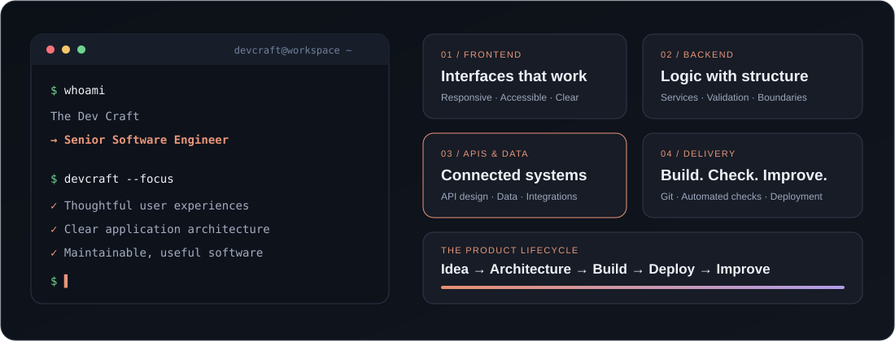
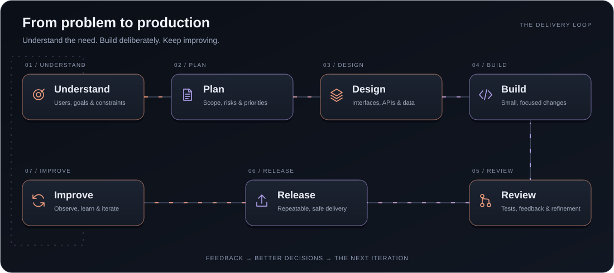

  

<strong>From an idea to a working application.</strong>

<h2 align="center">Who I Am</h2>

I’m a **senior software engineer** working across the full stack—from frontend interfaces to backend services, APIs, and databases.

I care about how a system holds up as it grows: clear boundaries, dependable integrations, sensible data models, and code another engineer can pick up without guesswork. I’m comfortable working across different codebases and choosing tools around the problem at hand.

<h2 align="center">How I Ship</h2>

<em>A clear plan, small changes, and feedback at every step.</em>

I turn the problem into a plan, make the design decisions explicit, and build in small steps. Review and testing shape the release; feedback shapes what comes next.

### What I bring to a project

- **Turn requirements into a clear plan:** map the user journey, API contracts, and data model before implementation gets complicated.
- **Connect the full stack:** keep interfaces, services, and integrations consistent as features grow.
- **Make changes easier to maintain:** use meaningful tests, practical code reviews, and documentation that explains the decisions.
- **Keep delivery steady:** break work into manageable changes and make builds and releases repeatable.

